# Example 1: A Typical 1-Day, 3-Round, In-Person Competition

This competition will run as follows:

- All competitors will fly three rounds of the same schedule.
- Each round will be normalised to 1000, based on the best raw-score in the round.
- The best two rounds for each competitor will count to the competition result.

In FCScore, the competition will look like this:

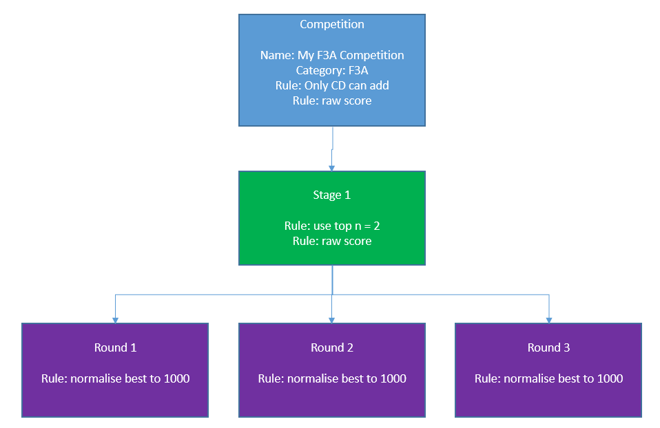

## Create the Competition

- On the menu ribbon, click on the trophy icon to bring up the competition menu.
- Select **Create Competition**.

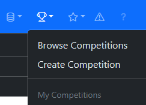

- A new pop-up will appear to create the competition.
- Enter the competition name and select the category from the pulldown.
- For this example, we do not want competitors to register themselves, and we only need normalisation for the rounds.
- Optionally add a description, and enter the planned start and end dates.

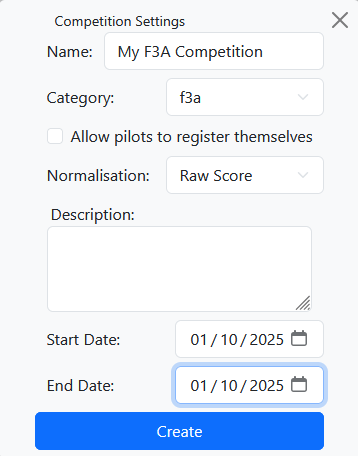

- Click the **Create** button.

Your new competition is shown:

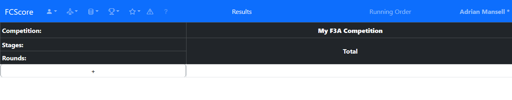

## Add a Stage

- Click on the bar containing the name of your competition to bring up the competition pop-up.
- Select **Add New Stage**

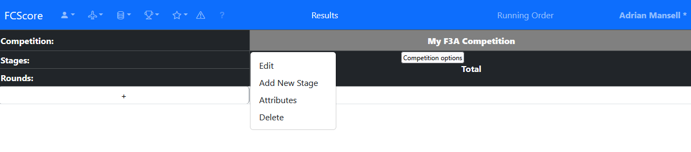

- This brings up the stage pop-up.
- Only the best two-from-three rounds count, so we add the **Use top n** rule with a value of 2.

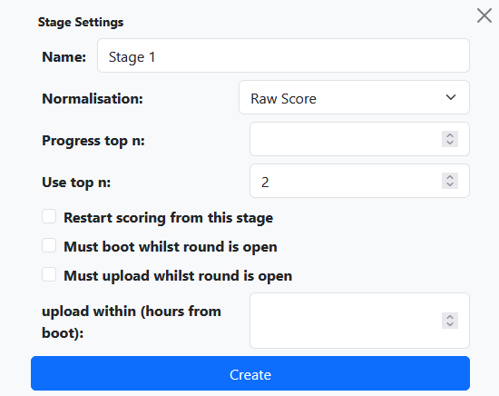

- Click the **Create** button.

Your competition now has the stage:

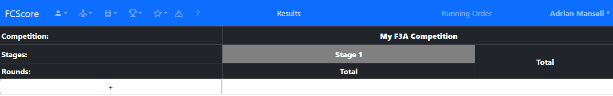

## Add Three Rounds

- Click on Stage 1 to bring up the stage options pop-up.
- Select **Add New Round**

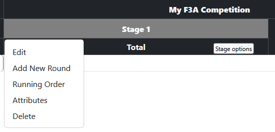

- This will bring up the New Round pop-up.
- Select the schedule for the round.
- For this example, we want the best raw-score normalised to 1000. Select **Best Score** in the normalisation pull-down, and enter 1000 in the **Normalise to** box.

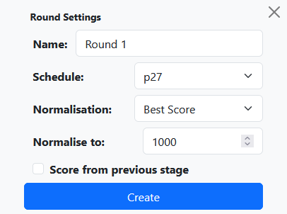

- Click the **Create** button.
- Repeat the above to add rounds 2 and 3.

Your competition now has three rounds:

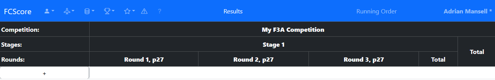

## Add the Competitors

- At the bottom left of your competition, click the + button. This will bring up the User Search pop-up.

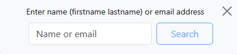

- Enter the name or email address of the FCScore user and click **Search**.

- FCScore users who match the search (if any) will be shown in the search results:

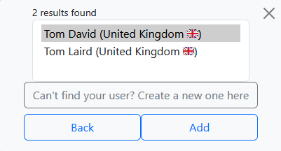

- If your competitor is already an FCScore User, click on them in the search results and then click **Add**.
- If your competitor is not an FCScore User, click on **Can't find your user? Create a new one here** to bring up the new user pop-up.

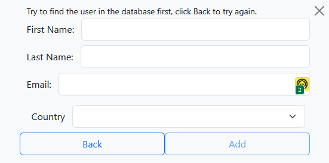

- Enter the competitors name and select their country.
- It is preferable to enter their email address - this will allow them to claim the account as their own (including their flights) in the future.
- Click **Add**.
- Repeat for all of your competitors.

Your competition now has competitors. In this example, I have added ten competitors:

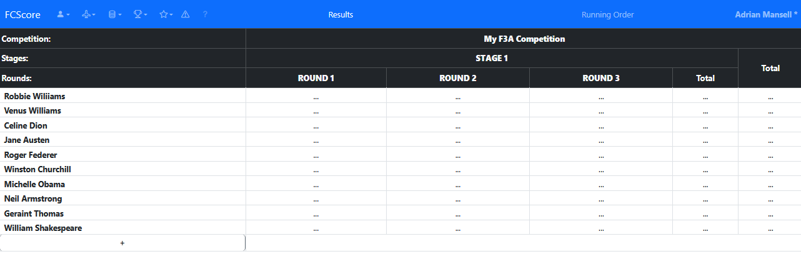

## Changing the Running Order

- In the menu ribbon, you will see that Results is highlighted.
- To change the running order, click instead on **Running Order**. To begin, each competitor has the same default running order in each round:

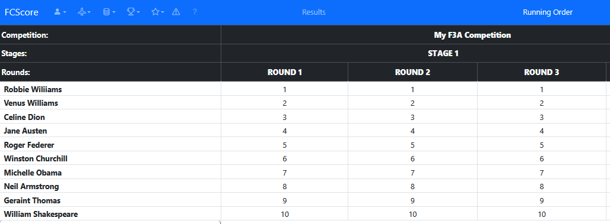

- Click on Stage 1 and select **Running Order** in the pop-up.

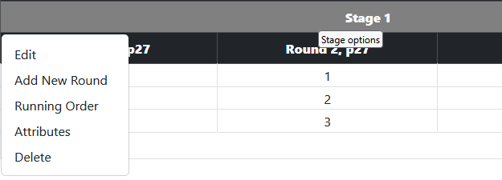

- Since there are ten competitors, we rotate the running order by three competitors each round.
- Click **Apply**.

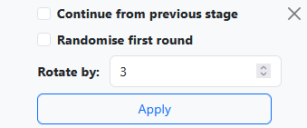

The running order is updated:

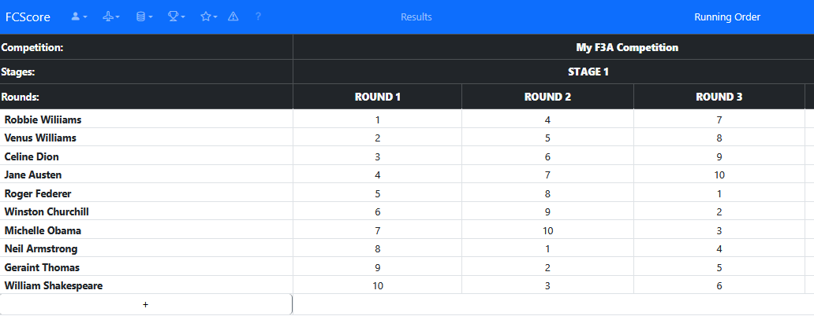

## Run the Competition

### Start Round 1

- Click on Round 1 to bring up the Round pop-up.
- Select **Open**.

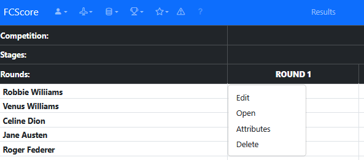

The colouring will change to show that the round is open:

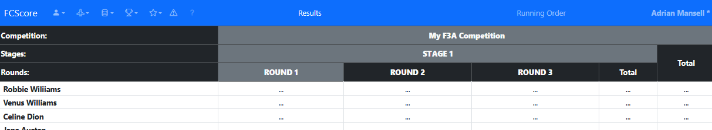

### Upload a Flight

- Create and score the flight as you would normally.
- Before uploading, select the **Link to competition after upload** checkbox.

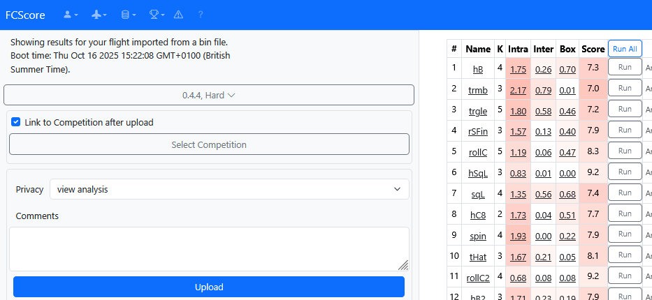

- Click the **Select Competition** button. A pop-up appears with the competitions you can upload to. Click **Select** on the correct competition:

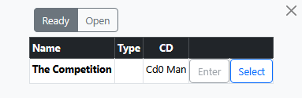

- You can now select the round and competitor for the flight, and click **Upload**.

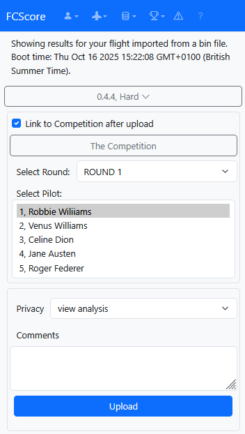

- The flight is uploaded and the updated competition is shown:

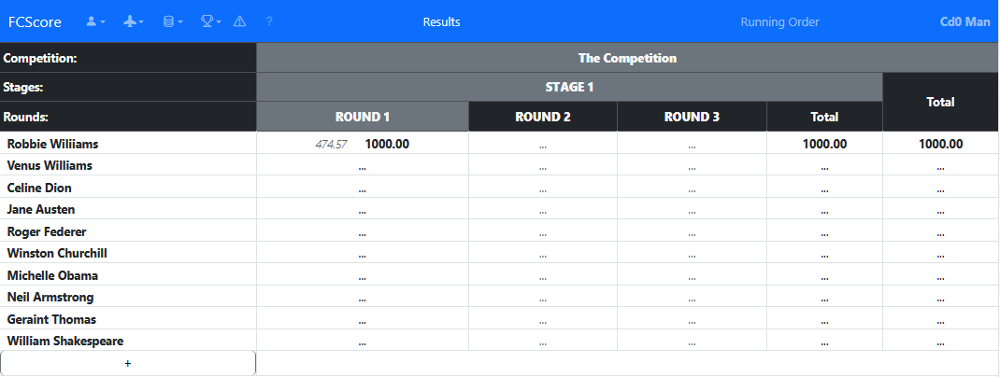

### Assign an Already Uploaded Flight

If you or a competitor has already uploaded a flight to the database, you can directly add it to the competition for that competitor for a round.

- Click on the **…** for competitor and round you want to assign a flight for. Select **Link Flight from DB**.

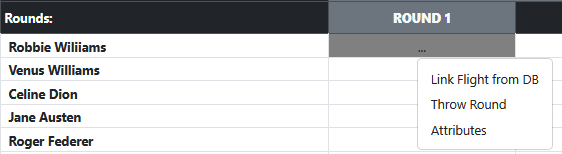

- A list of flights is shown for the competitor. Click **Link** for the desired flight.

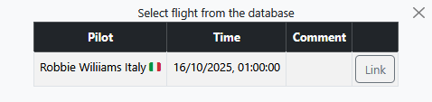

- The flight is added to the competition.

### Close the Round

Once you have added flights for the competitors, you should close the round.

- Click on the Round heading and click **Close** in the pop-up.

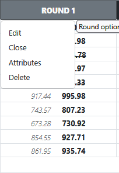

### Finish your Competition

Once all of the flights are flown and uploaded, your competition is complete. FCScore automatically applies the competition rules you have configured, such as normalisation and dropping rounds.

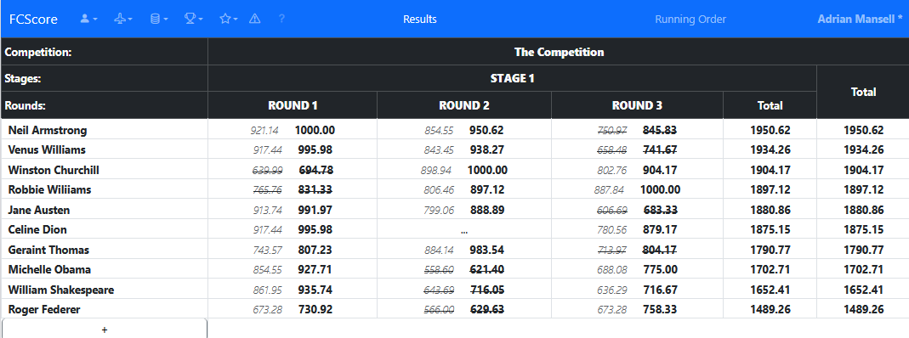
