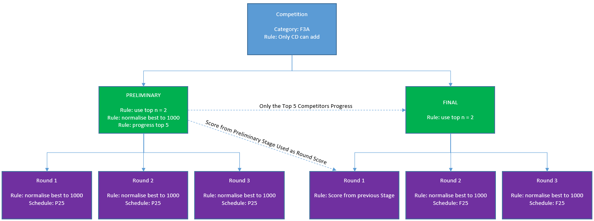
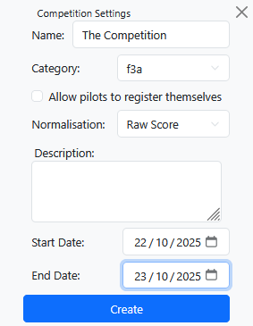
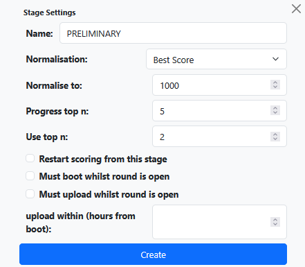
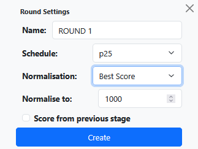
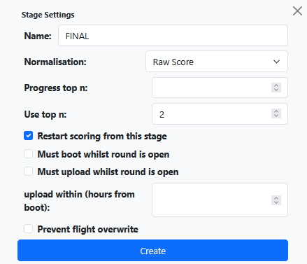
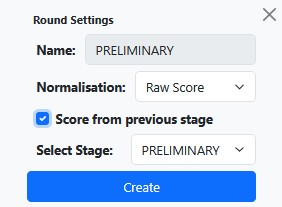
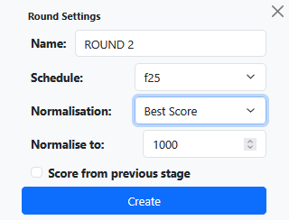
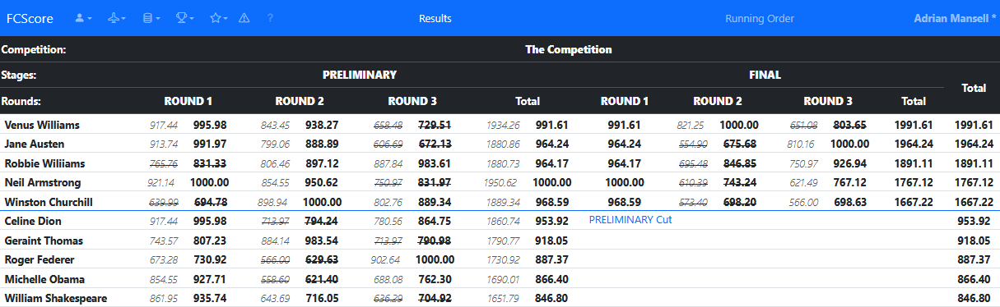

# Example 2 - An In-Person Competition with Preliminary and Final Stages

This competition will run as follows:

- It starts with a Preliminary stage:
    - All competitors will fly three rounds of the preliminary schedule.
    - Each round will be normalised to 1000, based on the best raw-score in the round.
    - The best two rounds will count to the Preliminary stage result.
    - The Preliminary stage result will be normalised to 1000 based on the best stage score.
- The top five competitors will then progress to Final stage.
    - The result from the preliminary stage will be included as the first round.
    - The Final competitors will fly two rounds of the final schedule.
    - Each flown round will be normalised to 1000, based on the best raw-score in the round.
    - The best two of the three scores will count to the final result.

Most of the steps to create and run the competition are the same as Example 1, but with more use of the features of FCScore competitions. We will focus on the differences.

In FCScore, the competition will look like this:

## Create the Competition

Follow the same process as example 1, with the following settings:

## Create the Preliminary Stage

The preliminary stage has the following features:

- The stage results are normalised to 1000; for this we set the normalisation to **Best Score**.
- Only the best two rounds for each competitor shall count to the stage result. For this we set **Use top n** to 2.
- Only the top five pilots will progress at the end of this stage. For this we use the **Progress top n** feature and set it to 5.

The resulting stage configuration is:

## Create the Preliminary Rounds

This step is the same as for example 1. The flights in each round are P25 schedule and the rounds have their best flight normalised to 1000. For each of the three rounds, the configuration is:

## Create the Final Stage

The final stage has the following features:

- It has three rounds; two flown F25 rounds and one round containing the scores from the Preliminary Stage.
- For the competitors progressing to this stage, the scores from the Preliminary Stage are not accumulated into the result (instead, they are included as the first round). For this, we select **Restart scoring from this stage**.
- Only the best two rounds count towards the result, so we use the **Use top n** feature set to 2.

The stage configuration is:

## Create the Final Rounds

### Round 1

This round is not a flown round, instead it contains the scores from the Preliminary Stage. For this, we use the **Score from previous stage** feature, selecting the Preliminary Stage:

### Rounds 2 and 3

These rounds are flown F25 rounds, with normalisation to 1000. Their configuration is:

## Add Competitors and Run the Competition

This follows the same steps as Example 1. The completed competition is shown below.

