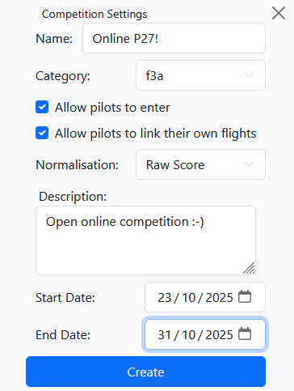
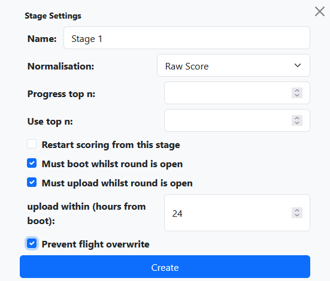
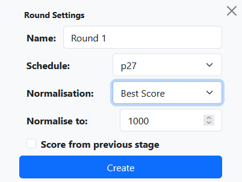
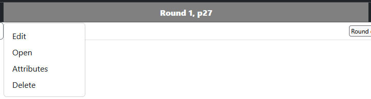
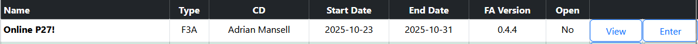
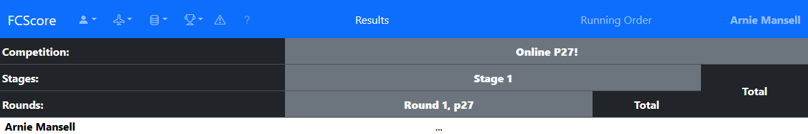

# Example 3 - An Open Online Competition

This competition will run as follows:

- The competition will have one round of schedule F3A P27.
- Competitors can add themselves to the competition.
- Competitors must upload and link their chosen flight within 24 hours of flying it. Only flights flown whilst the competition round is open are allowed.
- Each competitor may upload only one flight and may not subsequently replace that flight.
- The result will be normalised by best score to 1000 points.

## Create the Competition

Following the same steps as Example 1, create a new competition.

- To allow pilots to enter themselves, we select **Allow pilots to enter**.
- To allow pilots to add their own flight, we select **Allow pilots to link their own flights**.

## Add a Stage

Following the same steps as example 1, create a stage.

- To ensure competitors fly whilst the round is open, select **Must boot whilst round is open**.
- To ensure that the competitors upload whilst the comp is open and with 24 hours of flying, we:
    - Select **Must upload whilst round is open**
    - Set **upload within (hours from boot)** to 24
- To ensure that each competitor can only upload one flight, select **Prevent flight overwrite**.

## Add a Round

Following the same steps as Example 1, add a Round. The only setting to be made here is the normalisation, which we set to **Best Score** to 1000.

## Run the Competition

This is as simple as opening the round by clicking on it and selecting **Open**.

Your competition will appear in the competitions list, and Competitors can now add themselves by clicking the **Enter** button.

They will then appear in the competition.

To add a flight, they can link it as they upload it, or click the ellipsis (**…**) by their name in the round to link an already uploaded flight (see Example 1).

Once you are ready to finish the competition, simply close the round by clicking it and selecting **Close**.
