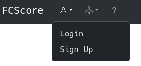

---
hide:
  - toc
---

# User Management

You can analyse your flights in FCScore without signing up, but if you do sign up you will be able to share and view flights in our database. Account actions are in the user menu (the person icon) in the top navigation bar.

## Registering

Choose **Sign Up** and fill in first name, last name, email address, password (at least ten characters, entered twice) and country. Tick the box to accept the Terms of Use (**View Terms of Use** shows them; among other things your uploaded flight data may be used to develop Flight Coach Score) and click **Register**.

## Verifying your email

FCScore sends a verification email. Follow its link to verify the address. Until then your profile says "Awaiting email verification" with a link to request another email. Without a verified email you cannot upload flights to the database or open the leaderboards.

## Logging in

Choose **Login** and enter your email address and password, then **Sign In**. Once logged in, the menu shows your name with **Profile** and **Logout**.

## Forgotten password

On the login page click **Forgotten your password?**, enter your email address and click **Reset Password**. The email contains a link to a page where you set a new password (**Reset My Password**).

## Profile

**Profile** lets you change your first name, last name, country and "About Me" text (**Update**), and change your password (**Update Password**). Your email address is shown but cannot be edited there. To delete your account, email the administrator address shown on the profile page.

## User pages

Selecting a pilot elsewhere in FCScore opens their page, showing their most recent upload, best flights, and a table of the schedules they have flown with a count and best rank.
