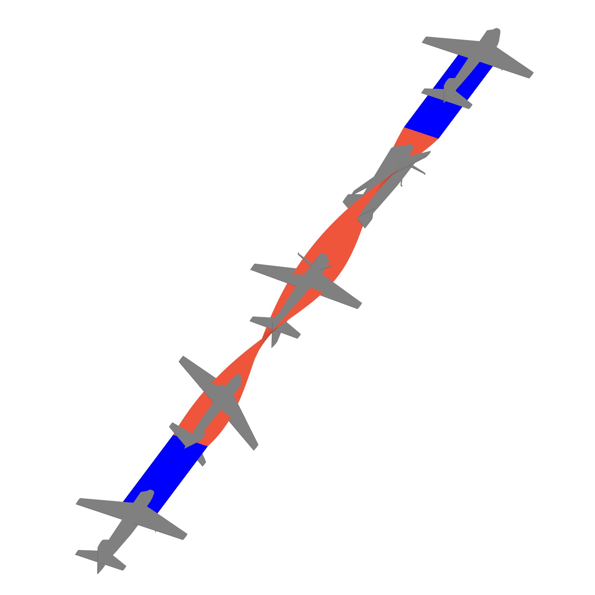
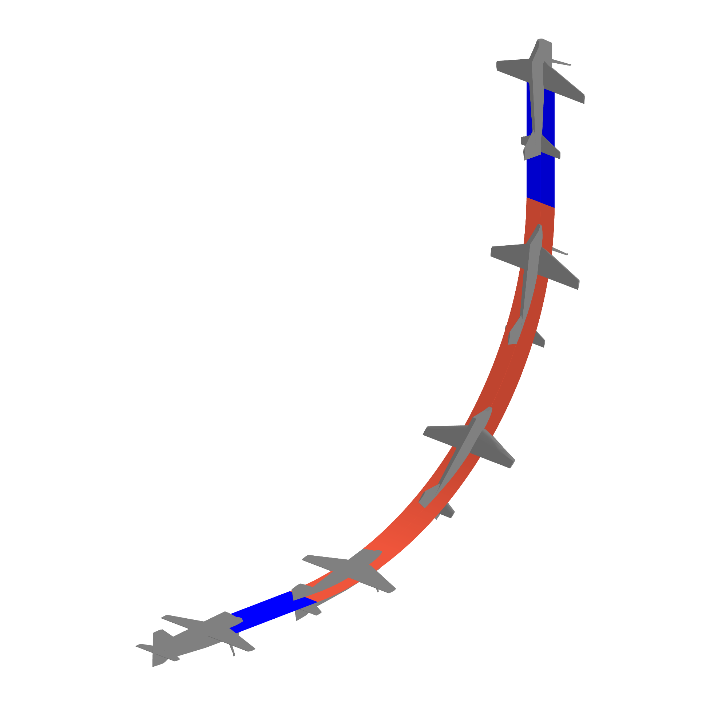
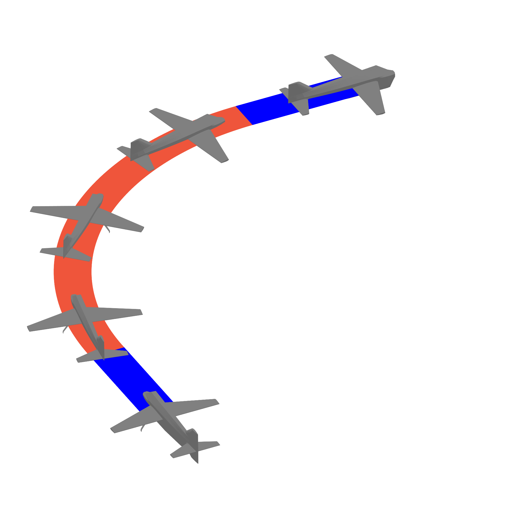
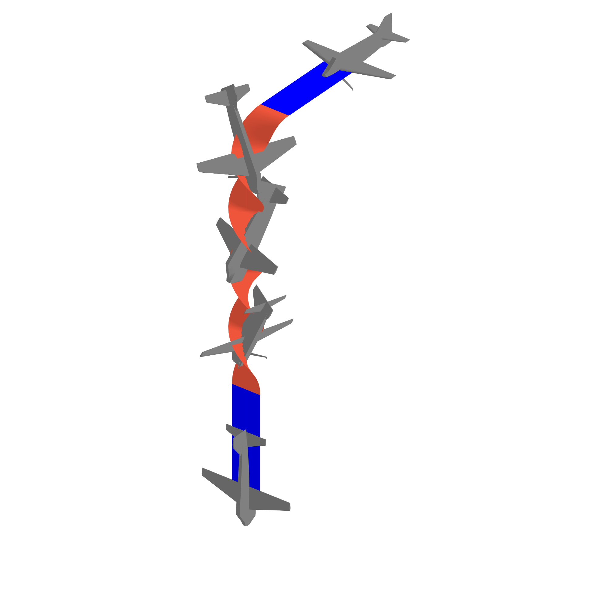
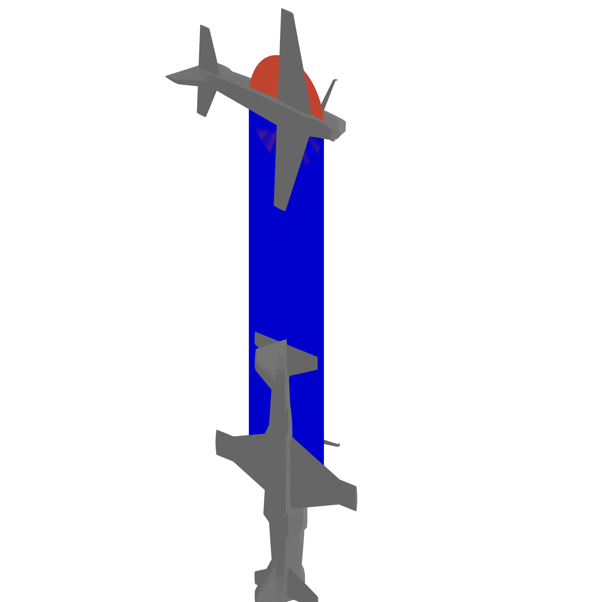

# Aerobatic Sequence Definition

Developing a computer model of an aerobatic sequence and the associated judging criteria is a fundamental part of the judging process.

## Principal Elements

An aerobatic manoeuvre is formed from a group of principal elements flown sequentially. A principal element is a basic building block and may be a loop, line (or roll), snap, spin or stallturn. We will add support for tailslides in a future release. All of these elements have a set of parameters that can be used to scale them, or adjust their geometry in other ways. For example, a line element has a length, a speed and a roll angle to integrate along its length.

       

As part of the judging process we have developed a method of automatically generating flight data to represent the principal elements and you have been able to view these template flights in the Flight Coach plotter for quite a while. The template generation process also creates all the downgrades applicable to the manoeuvre based on the rules of the aerobatic category the sequence is defined for.

## Available Sequences

The definition of new sequences is not trivial. Eventually we hope to introduce a user interface to allow you to create your own sequences and to parse [olan](https://openaero.net/) strings. Until then the sequences available in FCScore can be viewed [here](https://www.flightcoach.org/fcscore/schedule/browse/) and we will try to keep up to date with the known sequences for most aerobatic categories.
