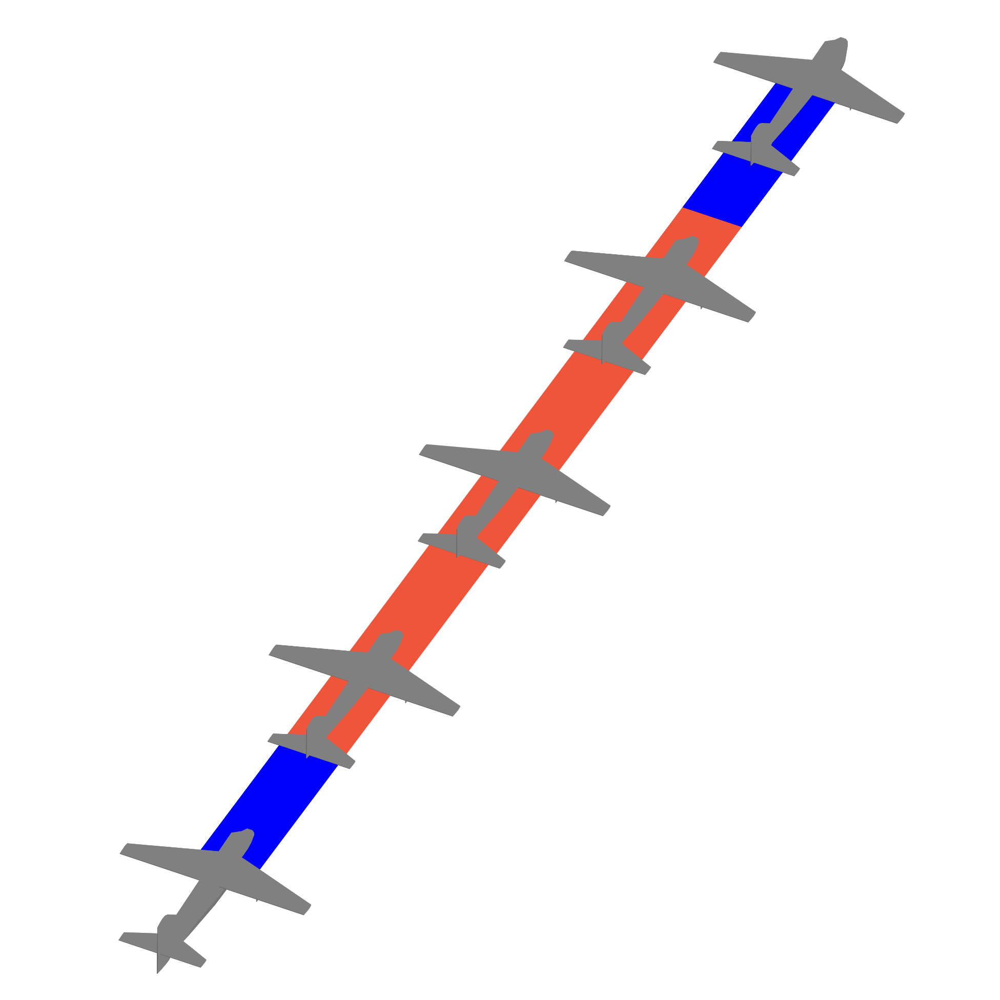
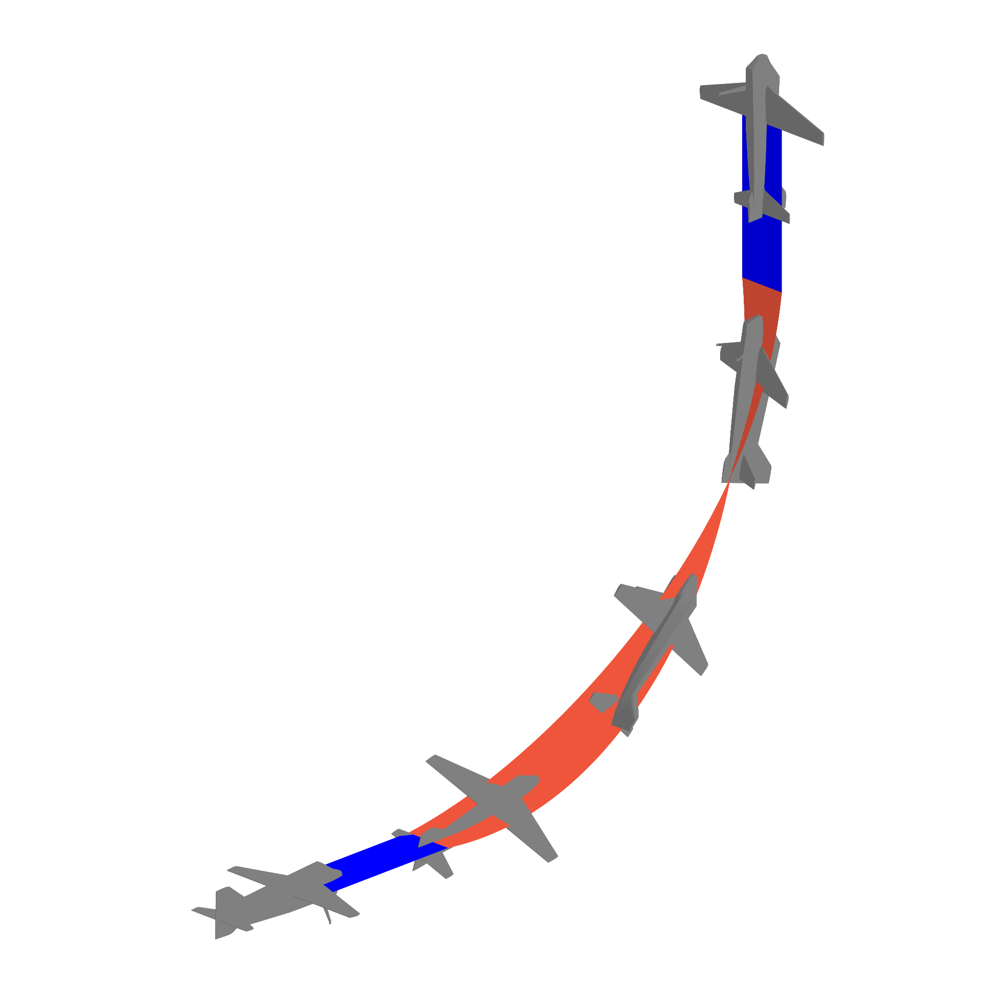
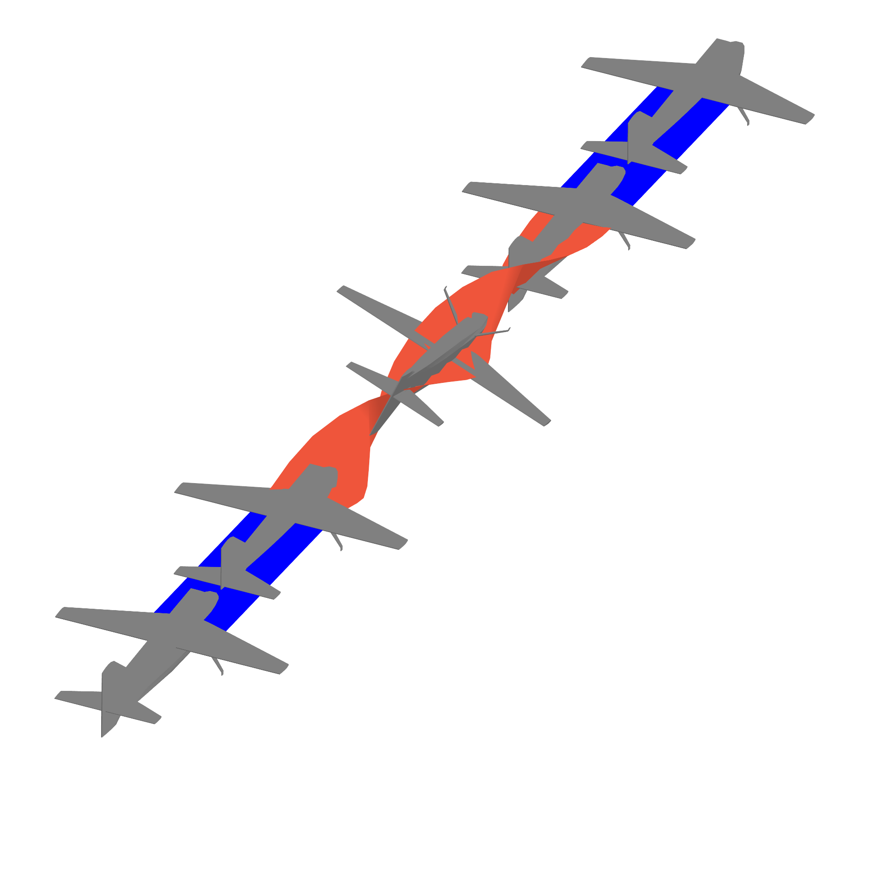

# Aerobatic Sequence Definition

Scoring a flight automatically needs a computer model of the sequence and of the judging criteria that apply to it. Each manoeuvre in a schedule is stored as a manoeuvre definition. The definition describes the manoeuvre's elements and parameters, and holds the downgrades for the category's rules.

## Principal Elements

An aerobatic manoeuvre is formed from a group of principal elements flown one after another. A principal element is a basic building block. The element types are:

- line (including rolls on a line)
- loop
- snap
- spin
- stall turn
- tail slide

Tail slides are supported in the element model, in the definition builders and in the OLAN parser. Each element has parameters that scale it or change its geometry. For example, a line has a length, a speed and a roll angle to integrate along its length.

       

From the definition, FCScore generates template flight data for the manoeuvre. The definition also creates all the downgrades that apply to the manoeuvre under the rules of the category. The template is what the flown manoeuvre is compared with, and it is the basis of the [element alignment](segmentation.md).

A definition can hold several options (for example alternative ways of flying a manoeuvre) and combinations, such as roll direction choices. Which option and combination you flew is worked out from your flight data when it is analysed.

## Creating Sequences

Schedules can be browsed in the client and new ones can be created in the schedule editor. The editor offers four input modes:

- **Open Aero.** Paste an [OLAN](https://openaero.net/doc/language.html) string, choose the rules and options, and press **Create**. The string is parsed by the analysis server using PyOlan, the Python OLAN parser.
- **Database.** Load a schedule that is already in the database.
- **Manual.** Start from an empty schedule for the chosen rules and build it manoeuvre by manoeuvre.
- **JSON.** Load a saved schedule file.

Once a schedule is loaded you can edit its manoeuvres and elements, and save it with **Post** (new) or **Patch** (existing). **Clear** discards it. You can only save a schedule you are allowed to edit.

PyOlan interprets an OLAN string as loops, lines, spins, stall turns and tail slides, plus snaps and rolls, and it is checked against OpenAero's own figure catalogue. It is still work in progress. A small set of OpenAero's renderer-only inverted variants is deliberately not parsed.

See [Creating a Schedule](../instructions/schedules/create.md) for step by step instructions.
